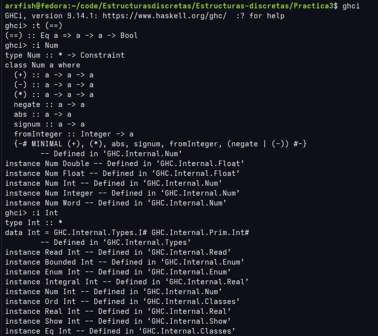

# Práctica 3
## Objetivo de la práctica
Aprender a definir tipos de datos propios utilizando `data`, diferencias las clases Num e Int y aplicar estos conceptos para resolver problemas.
### Actividad 1
- ¿Cuál es la diferencia entre Num e Int? 
    - Int almacena números sin decimales, generalmente utiliza un espacio de 32 o 64 bits.
    - Num es una clase o tipo general que abarca tanto enteros como a los decimales o puto flotante (double y float).

- Realiza un ejemplo en ghci, adjuntando una captura de pantalla. 

## Tiempo requerido
Tardé alrededor de 3 días, fueron cerca de 8 horas y media en total.

## Ejercicio favorito
El ejercicio que más me gustó fue el ejercicio de soloPares, ya que a comparación de el resto de los ejercicios me fue más sencillo resolverlo y verificar que funcionara, todo lo contrario al ejercicio 6 de primos.
## Comentarios extra
No tengo ningún comentario.
